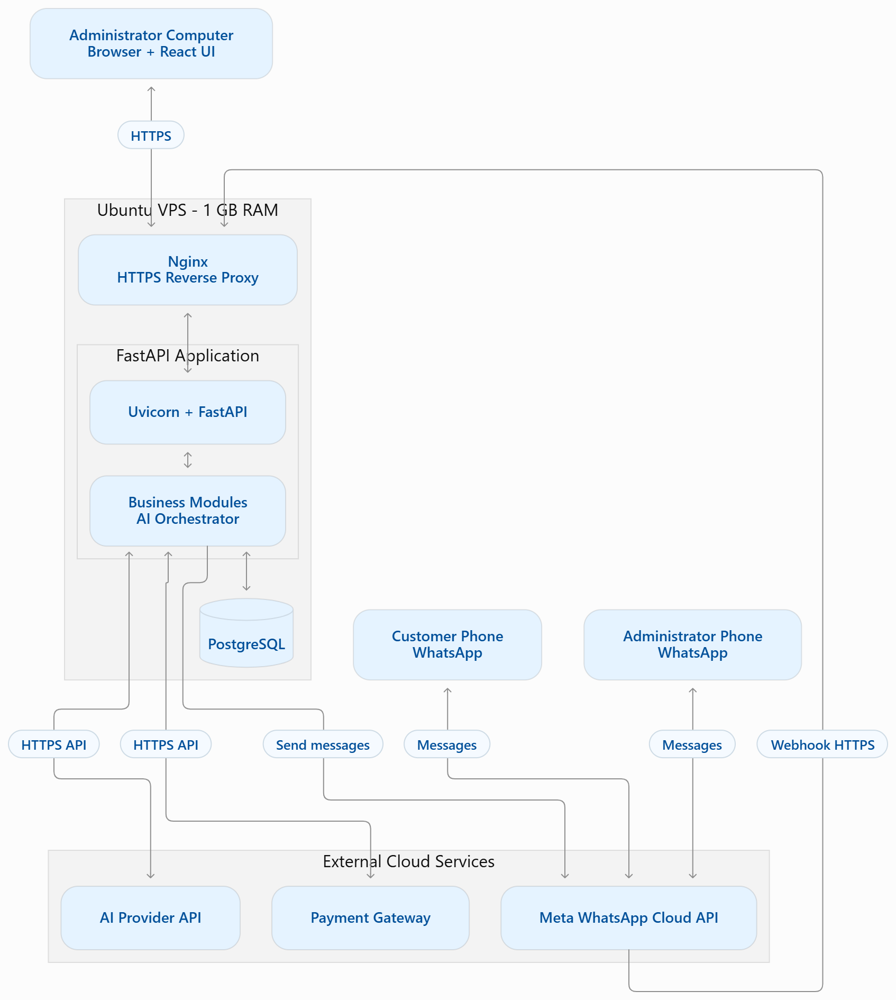
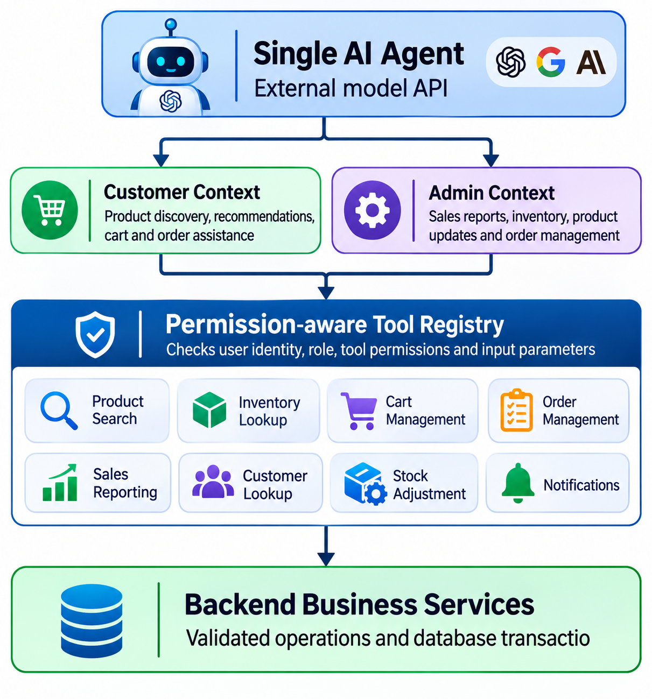

# Agentic Shop

An AI-assisted shopping system designed to connect customers and shop administrators through WhatsApp, with a React dashboard for desktop administration.

**Project status:** an integrated implementation is now included in `backend/` and `frontend/`. It provides a FastAPI application, PostgreSQL migrations, a React administration dashboard, one permission-aware AI orchestrator, verified WhatsApp webhooks, durable message delivery, Stripe checkout/refunds, and cash receipt tracking. Live integrations require your provider credentials and HTTPS configuration.

Start with the [local setup and deployment guide](docs/DEPLOYMENT.md). Review the [implementation plan](docs/IMPLEMENTATION_PLAN.md), [API and security boundaries](docs/API_AND_SECURITY.md), and [editable Mermaid diagrams](docs/DIAGRAMS.md).

The architecture below explains the system's design. Market-specific mobile-money/bank adapters, parameterized WhatsApp templates, and attachment-content interpretation are not implemented. Production PostgreSQL concurrency, provider credentials, and the 1 GB VPS workload must be validated in your deployment environment.

## Contents

- [System objectives](#system-objectives)
- [Architecture and diagrams](#architecture-and-diagrams)
- [Database design](#database-design)
- [Backend API](#backend-api)
- [AI agent design](#ai-agent-design)
- [AI usage and context management](#ai-usage-and-context-management)
- [Repository assets](#repository-assets)

## System objectives

### Customer experience

- Browse and search the product catalogue using natural language.
- View prices, descriptions, images, and availability.
- Receive personalised recommendations.
- Add and remove items from a shopping cart.
- Place and confirm orders, receive payment instructions, and track orders.
- Ask the AI shopping assistant for help with products and orders.

### Desktop administration

- View sales dashboards and analytics.
- Manage products, categories, inventory, and customers.
- Process orders and review transaction records.
- Manage staff accounts and permissions.
- Configure the AI agent and monitor WhatsApp conversations.
- Generate reports and exports.

### WhatsApp administration

- Retrieve daily sales, pending orders, and individual order details.
- Add or update products and inventory.
- View top-selling products and generate basic business reports.
- Receive low-stock alerts and new-order notifications.

### One agent, two operating contexts

The system uses one AI agent infrastructure with two permission-controlled contexts:

| Context | Responsibilities |
| --- | --- |
| Customer | Shopping assistance, product discovery, recommendations, and order support. |
| Administrator | Operational assistance, sales analysis, inventory queries, and authorised management actions. |

The backend must enforce permissions for each action, including actions requested through the AI agent.

## Architecture and diagrams

The proposed system connects the React dashboard and WhatsApp integration to shared backend business services. PostgreSQL provides persistent storage, and the AI agent accesses business operations through backend tools.

### Deployment

### Customer shopping and ordering

.png>)

### Administrator interactions through WhatsApp

.png>)

### AI tool calling

.png>)

### Order lifecycle

.png>)

### Order status transitions

.png>)

### Core domain model

.png>)

### Authentication and authorisation

.png>)

## Database design

PostgreSQL is the proposed primary database. Tables are organised around business functions:

| Table | Responsibility |
| --- | --- |
| `users` | Administrator and staff accounts. |
| `roles` | Roles such as administrator, manager, inventory staff, and support. |
| `permissions` | Granular access permissions. |
| `user_roles` | User-role relationships. |
| `customers` | Customer information. |
| `categories` | Product categories. |
| `products` | Product catalogue. |
| `inventory` | Current product stock. |
| `stock_movements` | Stock additions, deductions, and adjustments. |
| `carts` | Customer shopping carts. |
| `cart_items` | Products in shopping carts. |
| `orders` | Customer orders. |
| `order_items` | Individual products in orders. |
| `payments` | Payment transactions. |
| `payment_events` | Verified payment webhook events. |
| `conversations` | WhatsApp conversations. |
| `messages` | Incoming and outgoing messages. |
| `agent_sessions` | AI conversation context. |
| `notifications` | Customer and administrator notifications. |
| `audit_logs` | Administrative action history. |

### Database relationships

.png>)

### Design decisions

- **Prices:** store monetary amounts using fixed-precision decimal types.
- **Order history:** save product names, unit prices, and quantities as snapshots in `order_items` so catalogue changes do not alter historical orders.
- **Inventory:** record stock movements to explain each increase or decrease in stock.
- **Payments:** store provider references and payment status. Never store card details or mobile money PINs.
- **Conversation privacy:** retain only the data needed for the service, with appropriate retention and privacy controls.
- **Idempotency:** use unique event identifiers to handle repeated WhatsApp webhooks and payment callbacks without duplicating orders, payments, or stock changes.

## Backend API

The React dashboard and WhatsApp integration should use the same business services. The following routes are proposed:

| Method | Endpoint | Purpose |
| --- | --- | --- |
| `POST` | `/api/v1/auth/login` | Authenticate an administrator. |
| `GET` | `/api/v1/products` | Retrieve the product catalogue. |
| `POST` | `/api/v1/products` | Create a product. |
| `PATCH` | `/api/v1/inventory/{id}` | Update stock. |
| `GET` | `/api/v1/customers` | Retrieve customers for management. |
| `GET` | `/api/v1/carts/{id}` | Retrieve a cart. |
| `GET` | `/api/v1/orders` | Retrieve orders. |
| `POST` | `/api/v1/orders` | Create an order. |
| `POST` | `/api/v1/payments/initiate` | Initiate a payment. |
| `GET` | `/api/v1/reports/sales` | Retrieve sales analytics. |
| `POST` | `/api/v1/ai/chat` | Interact with the AI agent. |
| `POST` | `/webhooks/whatsapp` | Receive incoming WhatsApp events from Meta. |
| `POST` | `/webhooks/payments` | Receive payment notifications. |

Webhook routes are integration endpoints. Incoming events should be verified before processing. The backend should also expose a health-check endpoint for monitoring; its route is yet to be defined.

## AI agent design

Use a tool-based architecture: the language model requests backend tools, and business services validate permissions and inputs before executing operations. The model should not directly manipulate the database.

Deterministic backend logic should handle calculations and transactions. Customer and administrator contexts should share the agent infrastructure while exposing only the tools each user is authorised to use.

## AI usage and context management

Manage three concerns separately:

1. **Provider authentication:** protect the AI provider API key and keep it server-side.
2. **Token consumption:** measure input tokens, output tokens, and estimated cost.
3. **Conversation context:** control how much conversation history is sent with each request.

For a small VPS deployment, limit request size and processing work by:

- Keeping recent messages alongside a short conversation summary.
- Retrieving product information only when needed.
- Limiting tool calls per interaction.
- Using a smaller model for straightforward queries where appropriate.
- Delegating calculations and transactions to backend services.

### Proposed AI request record

| Field | Purpose |
| --- | --- |
| `provider` | AI provider. |
| `model` | Model identifier. |
| `input_tokens` | Tokens sent to the model. |
| `output_tokens` | Tokens generated by the model. |
| `estimated_cost` | Estimated API cost. |
| `customer_id` | Related customer, where applicable. |
| `conversation_id` | Related conversation. |
| `created_at` | Request timestamp. |

API keys must remain server-side and must never be included in the React application or WhatsApp messages.

## Repository assets

All ten diagram images are stored in the `images/` directory and referenced using relative paths. No externally hosted images are required.

| File | Diagram |
| --- | --- |
| [mermaid-diagram.png](./images/mermaid-diagram.png) | Deployment. |
| [mermaid-diagram (1).png](<./images/mermaid-diagram (1).png>) | Customer shopping and ordering. |
| [mermaid-diagram (2).png](<./images/mermaid-diagram (2).png>) | WhatsApp administration. |
| [mermaid-diagram (3).png](<./images/mermaid-diagram (3).png>) | AI tool calling. |
| [mermaid-diagram (4).png](<./images/mermaid-diagram (4).png>) | Order lifecycle. |
| [mermaid-diagram (5).png](<./images/mermaid-diagram (5).png>) | Order status transitions. |
| [mermaid-diagram (6).png](<./images/mermaid-diagram (6).png>) | Core domain model. |
| [mermaid-diagram (7).png](<./images/mermaid-diagram (7).png>) | Authentication and authorisation. |
| [mermaid-diagram (8).png](<./images/mermaid-diagram (8).png>) | Database relationships. |
| [image.png](./images/image.png) | AI agent architecture. |
