# Architecture diagram sources

The PNG diagrams in the repository root remain available for document exports.
The Mermaid sources below describe the implemented module boundaries.

## System architecture

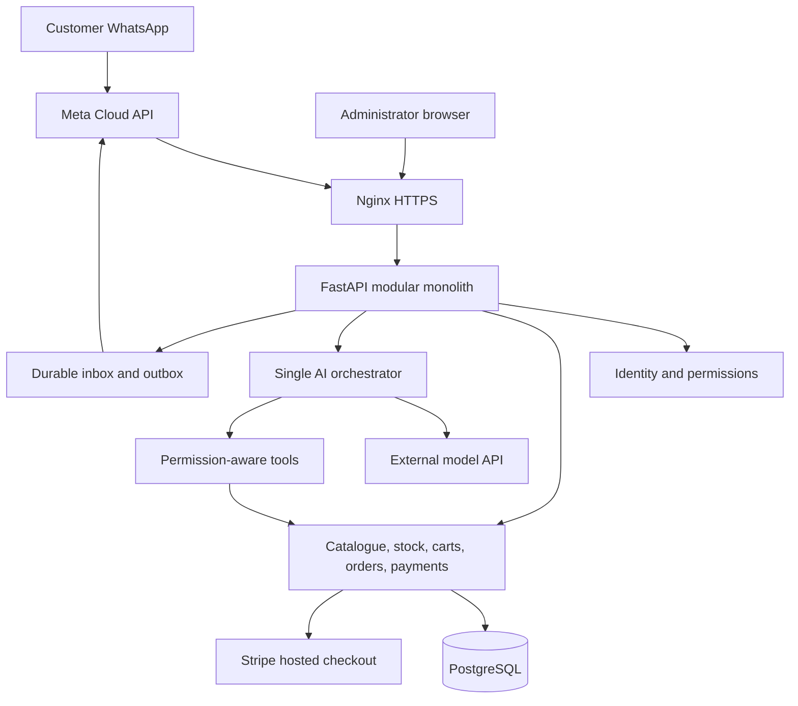

## Single agent

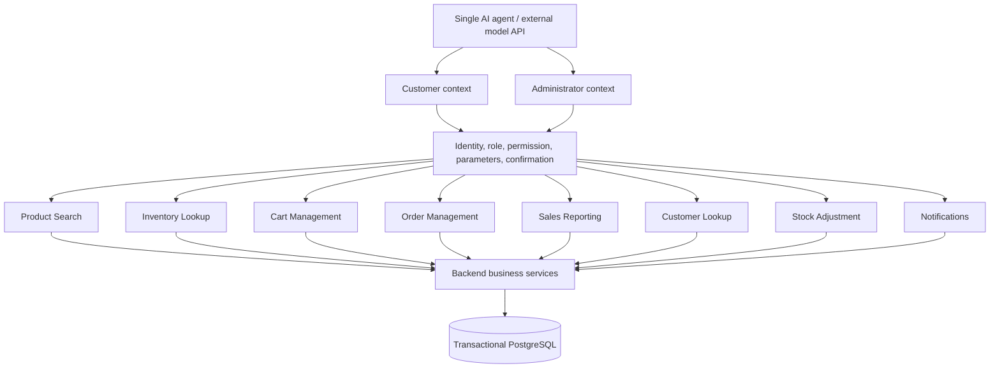

## Use cases

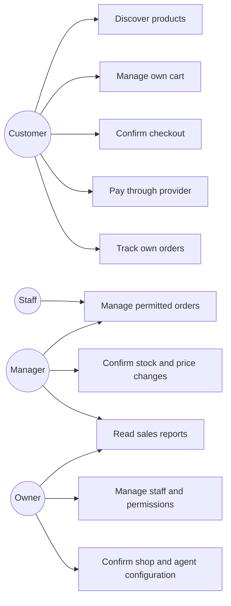

## Domain classes

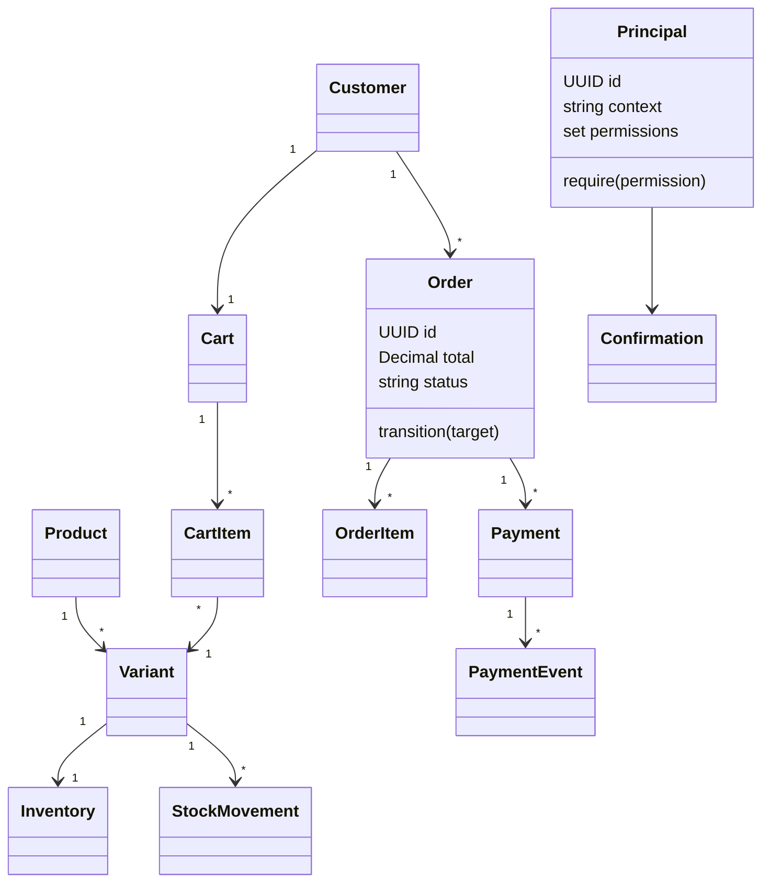

## Components

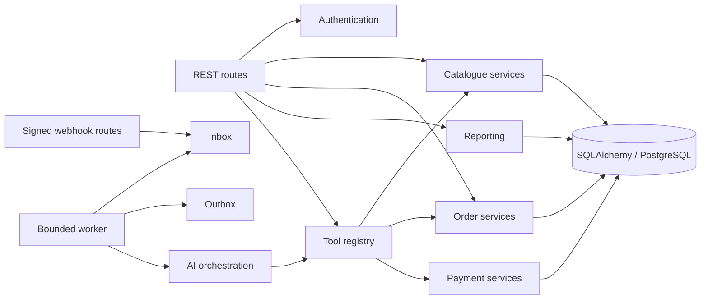

## Deployment

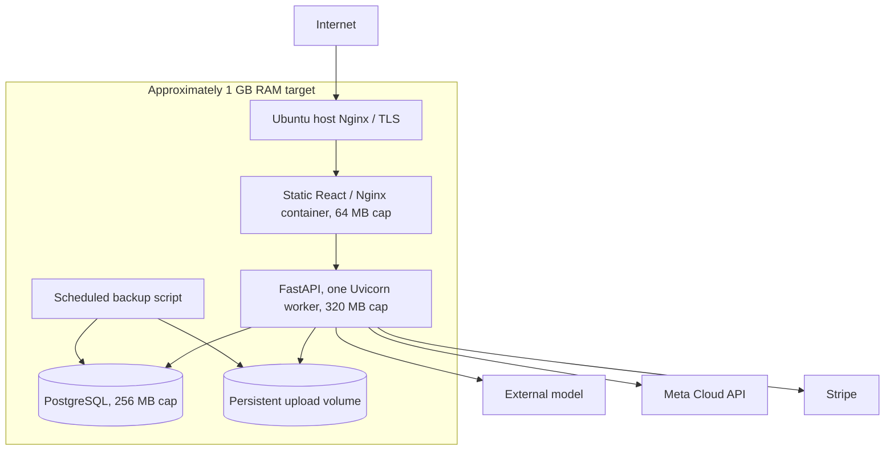

## Customer shopping sequence

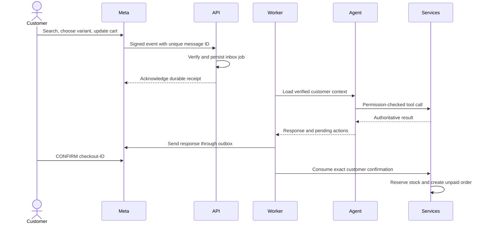

## Administrator sequence

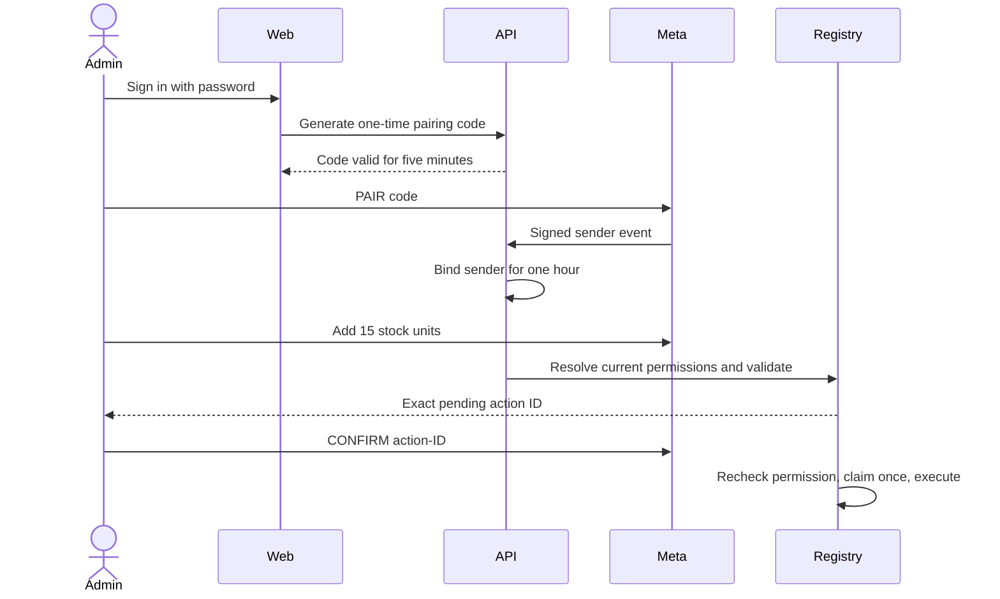

## Tool calling sequence

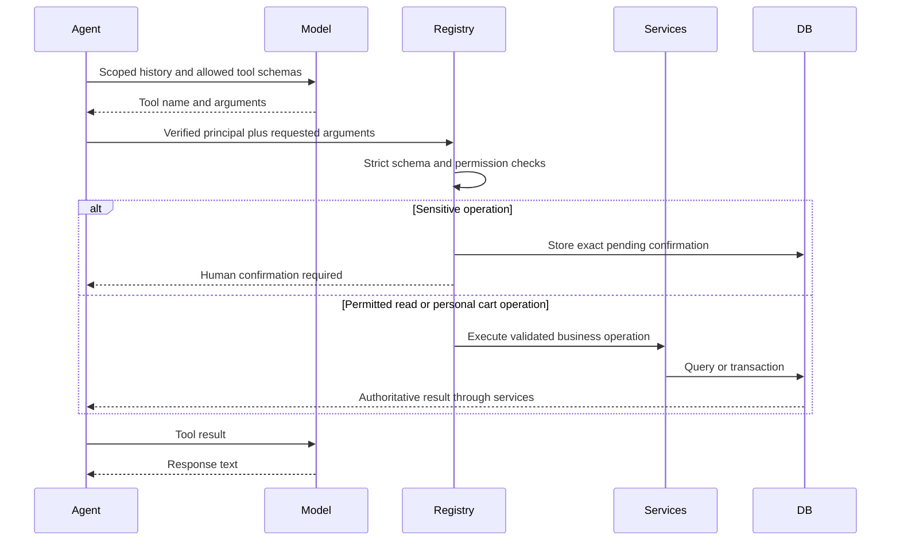

## Order lifecycle activity

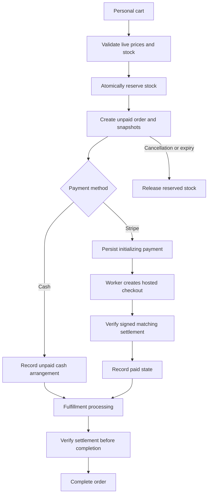

## Order state machine

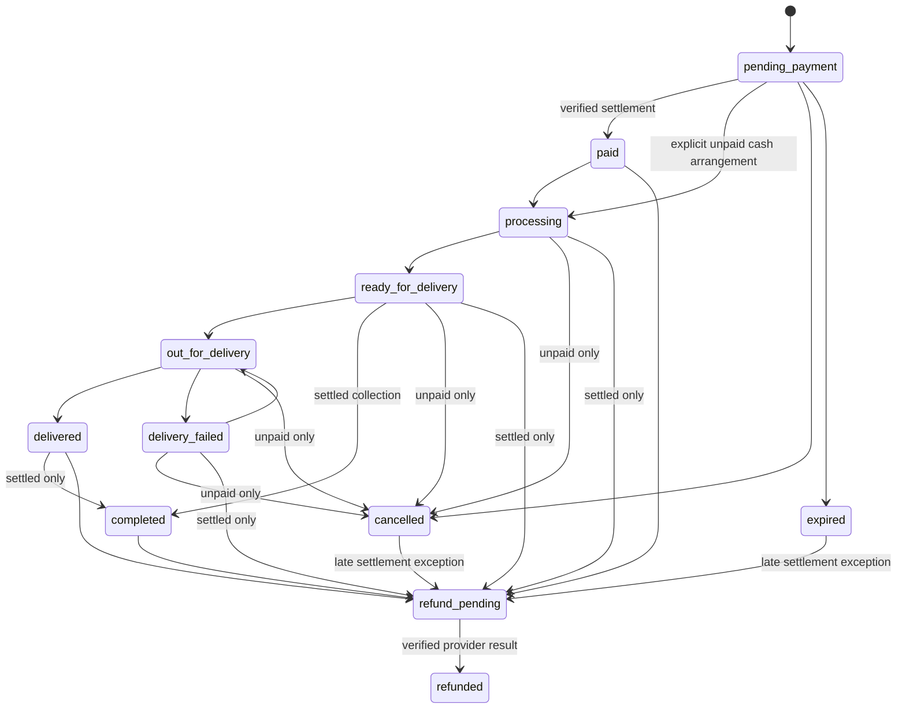

## Entity relationships

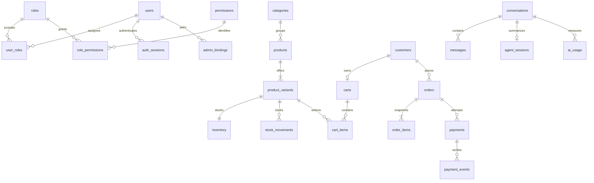
